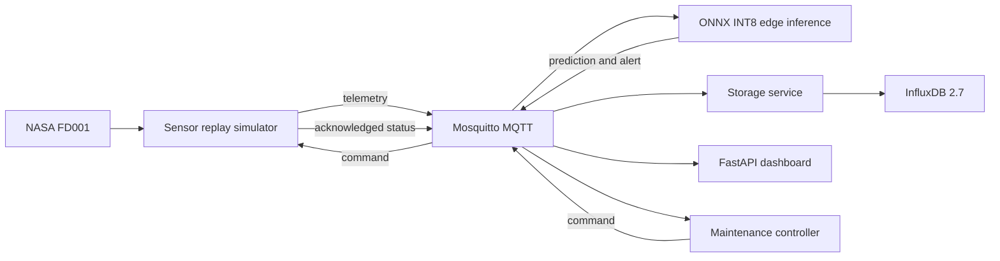

# AeroPulse — reproducible AIoT predictive maintenance

AeroPulse is an AIoT final-coursework software prototype. It replays NASA C-MAPSS FD001 turbofan data, predicts early failure risk with an ONNX INT8 1D-CNN, stores observations in InfluxDB, displays a live dashboard, and closes the loop with a simulated maintenance command.

**For an AI agent on a new computer:** follow the numbered procedure below from the repository root. Download data and train before starting the containers. No trained weights, datasets, course handouts, student reports, credentials, or original workspace history are distributed. Do not infer successful reproduction from this README's historical scores: generate and retain your own outputs.

## October 22 integration

The source now includes six replay engines, [Fleet dashboard](http://localhost:8010/fleet), per-engine freshness, SQLite offline cache and an InfluxDB general dashboard. See the [Vietnamese walkthrough](docs/defense-guide-vi.md), [measurement notes](docs/metrics-20261022.md), and [defense questions](docs/defense-questions-vi.md). These notes describe the original verified model at threshold 0.64; a fresh training run must use its own metadata and measurements. Model weights remain excluded.

Once Compose is running and `.env` is configured, install the optional InfluxDB dashboard:

```bash
INFLUXDB_URL=http://localhost:8086 INFLUXDB_ORG=aiot INFLUXDB_BUCKET=telemetry .venv/bin/python dashboard/create_general_dashboard.py
```

The script prints the dashboard URL. Fleet is available at `/fleet`, the engine console at `/?engine=FD001-100`. Ports bind to localhost. Do not copy another person's `.env`, cache, datasets or generated artifacts into this public repository.

## 1. Architecture and scope



Twelve Compose services (including six simulator instances): `mosquitto`, `influxdb`, `edge`, `storage`, `dashboard`, `controller`, `simulator` (100), and `simulator_095` through `simulator_099`. Training runs on the host; runtime containers do not install PyTorch. The engine console subscribes to MQTT and persists a bounded SQLite cache. The fleet dashboard queries historical InfluxDB predictions through server-side Flux.

| Topic suffix under `aiot/engine/{id}/` | Producer | Consumers |
| --- | --- | --- |
| `telemetry` | simulator | edge, storage, dashboard |
| `prediction` | edge | storage, dashboard |
| `alert` | edge | controller, storage, dashboard |
| `command` | controller or dashboard | simulator, dashboard |
| `status` | simulator | controller, storage, dashboard |

Messages use JSON and QoS 1. See [schema.py](src/aiot_pm/schema.py) for telemetry and prediction fields. The replay IDs are `FD001-095` through `FD001-100`. `schedule_maintenance` changes a Boolean state; it does not repair an engine or actuate hardware. `reset_maintenance` clears that state. Replay loops and resets rolling inference buffers when cycle numbers restart; maintenance state may stay true across loops.

## 2. Prerequisites and compatibility

- Git, `uv`, Python **3.11** (project permits 3.11–3.12), and a POSIX shell. Run all commands from the cloned root; the editable installation resolves configuration relative to the source checkout.
- Docker Engine/Desktop with Compose v2, running before the demo. Images are `python:3.11-slim`, `eclipse-mosquitto:2.0`, and `influxdb:2.7`; these tags are not immutable digest locks.
- CPU only; no GPU, CUDA, physical sensor, Raspberry Pi, ESP32, or microcontroller is required. A laptop with 8 GB RAM and several GB of free disk is a practical starting point, not a measured minimum. Original development used Apple M1 Pro and 16 GB RAM.
- Internet for Python packages, the 12.4 MB dataset archive and container images. After setup, training and the local demo do not require a cloud service or API key.
- Ports 1883 (MQTT), 8086 (InfluxDB), 8010 (dashboard) available on localhost, or choose alternatives in `.env`.

The recorded host environment is Python 3.11.13, PyTorch 2.14.0, ONNX 1.23.0, ONNX Runtime 1.30.0, NumPy 2.4.6, pandas 2.3.3, scikit-learn 1.9.1 and paho-mqtt 2.1.0. [requirements-macos-arm64.lock.txt](requirements-macos-arm64.lock.txt) records exact installed packages for macOS ARM64. It is a version snapshot, not a hash-locked or universal lockfile. Linux runtime dependencies resolve separately from [requirements-runtime.txt](requirements-runtime.txt).

Fresh verification and its boundaries are recorded in [docs/reproduction-check.md](docs/reproduction-check.md). Native Linux host training, Windows, WSL2 and physical edge hardware have not been verified. On Windows, use WSL2 with Docker integration and the POSIX commands below; treat that path as untested. Do not force macOS-specific pins such as `uvloop` onto native Windows.

## 3. Clone and install

```bash
git clone https://github.com/HuynhThanhQuan/aeropulse-aiot-predictive-maintenance.git
cd aeropulse-aiot-predictive-maintenance
uv venv --python 3.11
```

On macOS ARM64, recreate the recorded host dependencies:

```bash
uv pip install --python .venv/bin/python -r requirements-macos-arm64.lock.txt -e '.[train,dev]'
```

On another supported Python platform, resolve the declared version ranges instead and record the resulting versions. This is a portability route, not a claim of identical results:

```bash
uv pip install --python .venv/bin/python -e '.[train,dev]'
uv pip freeze --python .venv/bin/python > results/environment.txt
```

`make setup` is the range-based installation shortcut. Activation is optional because all subsequent host commands use `.venv/bin/python` explicitly. Do not install this project as a standalone wheel and assume its external `config/` and `web/` resources are packaged.

## 4. Obtain the dataset from its publisher

```bash
make download
```

The downloader tries the [NASA Open Data resource](https://data.nasa.gov/dataset/cmapss-jet-engine-simulated-data), then the [NASA-authored Zenodo record, DOI 10.5281/zenodo.15346912](https://zenodo.org/records/15346912). It checks archive MD5 `79a22f36e80606c69d0e9e4da5bb2b7a` and prevents extraction paths escaping the data directory. MD5 here identifies the published archive; it is not a security signature. Download only from these publisher sources and consult their current usage terms. The NASA catalog lists “License not specified”; this repository does not assert a new dataset license or redistribute the archive or accompanying paper.

Expected local files: `data/raw/train_FD001.txt`, `test_FD001.txt`, `RUL_FD001.txt`, plus FD002–FD004 equivalents extracted by the script. Only FD001 is used. Its training file has 20,631 rows / 100 engines; test file has 13,096 rows / 100 engines. Files have 26 whitespace-separated columns: engine, cycle, three operating settings, 21 sensors.

The downloader skips an existing complete set of filenames; it does not rehash individual existing text files. For a fresh verification, use an empty `data/raw/` directory. If automatic download is unavailable, obtain the same archive from the linked record, verify its MD5 locally, and extract it into `data/raw/` without an extra enclosing directory. Never disable the checksum to accept an unknown archive.

Dataset reference: A. Saxena, K. Goebel, D. Simon, D. Eklund, *Damage Propagation Modeling for Aircraft Engine Run-to-Failure Simulation*, PHM 2008.

## 5. Train, export, and evaluate

```bash
OMP_NUM_THREADS=1 MKL_NUM_THREADS=1 PYTHONUNBUFFERED=1 make train
make benchmark
.venv/bin/python scripts/collect_measurements.py
```

The explicit thread limits avoid excessive OpenMP overhead observed on the development Mac; they apply only to training. Record any different thread settings used on your machine. `make train` without these limits is also available, but was substantially slower in this verification.

[config/config.yaml](config/config.yaml) is the source of experiment parameters. Defaults: seed 42, 80 training engines / 20 validation engines, 30-cycle windows, warning label `RUL <= 30`, sensors 2/3/4/7/8/9/11/12/13/14/15/17/20/21. StandardScaler fits training engines only. Inputs are float32 `[batch, 14, 30]`. The 4,185-parameter CNN uses Conv1d/BatchNorm/ReLU, max pooling, another convolution block, global average pooling and a single logit. Training uses weighted BCE, Adam at 0.001, batch size 128, up to 12 epochs and patience 4.

The best epoch and threshold are chosen on validation F1. Static ONNX QDQ quantization calibrates on up to 512 training windows, with unsigned INT8 activations and signed INT8 per-channel weights. Export uses opset 17. Do not tune on official test labels.

Expected generated outputs (ignored by Git):

| Path | Meaning |
| --- | --- |
| `models/tiny_cnn_state.pt` | local PyTorch state dictionary |
| `models/tiny_cnn_fp32.onnx`, `tiny_cnn_int8.onnx` | deployable models |
| `models/metadata.json` | scaler, feature order, window size, split IDs, threshold, validation metrics |
| `data/processed/validation_windows.npz` | 3,272 held-out windows; 620 positives |
| `results/training_history.json` | per-epoch development metrics |
| `results/benchmark.json`, `benchmark.md` | FP32/INT8 validation metrics and measured performance |
| `submission/evidence/official-test-evaluation.json` | separate all-window and endpoint-per-engine test metrics |
| `submission/evidence/benchmark-{1,2,3}.json`, `benchmark-median.json` | repeated measured host performance |
| `submission/evidence/device.json`, `dataset-model.json` | host context and artifact hashes |

`collect_measurements.py` also runs a discarded warm-up benchmark. Each model benchmark uses its own process, 20 inference warm-ups, 300 timed batch-1 calls, and CPU ONNX Runtime. Throughput is reciprocal inference latency, not measured end-to-end MQTT throughput. Legacy JSON keys ending `_kb` mean **KiB**, and `_mb` mean **MiB**. RSS is whole-process memory, not model-only RAM or MCU Flash. See [benchmark protocol](docs/benchmark-protocol.md).

Official test RUL is `max_observed_cycle - cycle + RUL_FD001 endpoint`. The measurement script freezes the metadata threshold and evaluates both 10,196 overlapping windows and one final window per engine. These are distinct denominators and must not be pooled. Retraining may change model hashes, threshold and scores across versions or hardware; never overwrite measured results to match a reference value.

## 6. Configure and start the simulated system

```bash
cp .env.example .env
```

Edit `.env` locally: replace `INFLUXDB_PASSWORD` and `INFLUXDB_TOKEN` placeholders with values used only for this local demo (password at least 8 characters). They initialize a new local InfluxDB instance; they are not GitHub credentials. Do not commit `.env`. Compose reads it automatically, while host Python scripts do not.

| Variable | Default/example | Purpose |
| --- | --- | --- |
| `INFLUXDB_PASSWORD`, `INFLUXDB_TOKEN` | placeholders; replace locally | Compose database initialization / application access |
| `DASHBOARD_PORT` | `8010` | localhost dashboard mapping |
| `MQTT_PORT` | `1883` | host broker port; containers always use 1883 |
| `INFLUXDB_PORT` | `8086` | host database mapping |
| `MQTT_HOST` | `localhost` | host Python clients; Compose uses `mosquitto` |
| `INFLUXDB_URL` | `http://localhost:8086` | host evidence collector; update if host port changes |
| `INFLUXDB_ORG`, `INFLUXDB_BUCKET` | `aiot`, `telemetry` | host clients; Compose uses these fixed names |
| `MODEL_PATH`, `METADATA_PATH` | `models/tiny_cnn_int8.onnx`, `models/metadata.json` | host runtime overrides; Compose mounts these fixed paths |

```bash
docker compose config --quiet
docker compose up -d --build
docker compose ps
curl -fsS http://localhost:8010/api/health
```

Expected health: `{"status":"ok","mqtt_connected":true}`. Open [dashboard](http://localhost:8010) and [InfluxDB](http://localhost:8086). InfluxDB username is `admin`; use your local password, organization `aiot`, bucket `telemetry`. Allow startup retries; `depends_on` orders container startup but does not guarantee application readiness.

After at least 30 sensor cycles (~7.5 seconds at the Compose interval 0.25 s), predictions appear. Within a replay, expect high risk → alert → automatic `schedule_maintenance` → acknowledged `maintenance_scheduled=true`. The historical reference crossed at cycle 170; a retrained model is not guaranteed to cross at that exact cycle. Observe the event timeline rather than relying on the final state alone.

```bash
curl -fsS 'http://localhost:8010/api/snapshot?engine_id=FD001-100'
curl -fsS -X POST http://localhost:8010/api/command \
  -H 'Content-Type: application/json' \
  -d '{"engine_id":"FD001-100","action":"reset_maintenance"}'
docker compose logs --tail=80 edge controller simulator storage
```

The reset response has `accepted: true`; check subsequent status for acknowledgement. High risk can automatically schedule maintenance again. In InfluxDB Data Explorer, run:

```flux
from(bucket: "telemetry")
  |> range(start: -10m)
  |> filter(fn: (r) => r.engine_id == "FD001-100")
  |> group(columns: ["_measurement"])
  |> count()
```

Expect `telemetry`, `prediction`, `alert`, and `status` after a full risk cycle. To capture fresh MQTT events and database counts, export your own `.env` into the host script's environment (do not source an untrusted file):

```bash
set -a
. ./.env
set +a
.venv/bin/python scripts/capture_demo_evidence.py
```

This script restarts **this Compose project's simulator**, waits about 66 seconds, then writes MQTT capture, snapshot, closed-loop events, Flux query and counts under `submission/evidence/`. It does not capture screenshots or video. If using alternate ports, set `INFLUXDB_URL` to match `INFLUXDB_PORT`. Inspect logs for database initialization delays before capturing.

```bash
docker compose down
```

This stops the demo and preserves its named database volume. Deleting the volume destroys stored observations; do so only when you deliberately want a new empty demo database. Do not alter or stop unrelated Compose projects.

## 7. Validate and diagnose

```bash
make test
make lint
.venv/bin/python -m ruff check scripts
docker compose config --quiet
```

The six original tests cover engine split isolation, window labels, rolling preprocessing, schema/topic behavior, and storage conversion. They are not a hardware or full-system test. Validate health, predictions, MQTT feedback and database persistence separately using section 6.

| Symptom | Action |
| --- | --- |
| `Dataset not found` | Run `make download`; verify `data/raw/train_FD001.txt`. |
| Download/checksum failure | Check publisher availability and archive identity; do not bypass checksum. |
| Model/metadata missing | Run `make train` before Compose; keep model and metadata from the same run. |
| `ModuleNotFoundError` | Use `.venv/bin/python`; if the editable path is stale, run `uv pip install --python .venv/bin/python --reinstall-package aiot-predictive-maintenance -e '.[train,dev]'`. |
| Dependency wheel unavailable | Use Python 3.11 on a supported OS; resolve ranges on another platform and record versions. |
| Port already allocated | Change host ports in `.env`; update curl URLs and `INFLUXDB_URL`. Container service ports stay fixed. |
| MQTT connected but no predictions | Wait 30 cycles; check edge/simulator logs and model mount. |
| InfluxDB unauthorized | Match local token to the one used to initialize that volume. Changing `.env` does not reset an existing database. |
| Empty dashboard after restart | The engine console loads its SQLite cache; wait for live replay. Fleet requires InfluxDB. |
| Maintenance already true after replay loops | Expected state retention; reset and inspect timestamped events. |
| INT8 slower than FP32 | Report actual timings; this very small model can be dominated by runtime overhead. |

## 8. Historical evidence and limitations

These retained JSON summaries came from the original development project on 12 October 2026; they are reference evidence, not freshly generated values or promised targets. The model hashes are in [dataset-model.json](docs/reference-results/dataset-model.json). Original weights remain local and are not included here.

| Scope | FP32 | INT8 |
| --- | ---: | ---: |
| Model size, KiB | 17.6367 | 13.2500 |
| Validation F1, 3,272 windows | 0.8710 | 0.8718 |
| Three-run median mean inference latency, ms | 0.0270 | 0.0235 |
| Official test endpoint F1, 100 engines | 0.8000 | 0.8000 |

The [benchmark medians](docs/reference-results/benchmark-median.json) were measured on Apple M1 Pro, 16 GB RAM, macOS 26.5.1, Python 3.11.13 and ONNX Runtime 1.30.0. The earlier single development run had lower mean latencies (FP32 0.0154 ms, INT8 0.0148 ms); it must not be confused with these later medians. The original Linux container used ONNX Runtime 1.31.0.

At frozen threshold 0.64, the [official test](docs/reference-results/official-test-evaluation.json) INT8 endpoint precision is 0.90, recall 0.72, accuracy 0.91; TN/FP/FN/TP = 73/2/7/18, with 25 positives. All-window test F1 is 0.7049. Validation is used for model and threshold selection, so its F1 is not independent test evidence. Engine 100 is a validation replay, not a separate deployment trial.

This is simulated run-to-failure data and a binary early-warning classifier, not direct RUL regression or a production aircraft safety system. Physical sensing, actuators, on-device deployment, field reliability, TLS/authenticated MQTT and production access control are not implemented. Published ports bind to localhost, but MQTT and dashboard operations remain unauthenticated inside the demo network. Do not expose the classroom stack publicly. No benchmark on the final defense device is confirmed.

## File map

| Path | Role |
| --- | --- |
| `src/aiot_pm/data.py`, `preprocessing.py`, `model.py`, `train.py` | windows, scaling, CNN, training/export |
| `src/aiot_pm/download_data.py`, `benchmark.py` | publisher download, host comparison |
| `src/aiot_pm/simulator.py`, `edge_service.py` | sensor replay and INT8 inference |
| `src/aiot_pm/controller_service.py`, `storage_service.py` | feedback and persistence |
| `src/aiot_pm/dashboard.py`, `web/` | FastAPI API and HTML/CSS/JS dashboard |
| `src/aiot_pm/config.py`, `schema.py`, `mqtt_utils.py` | shared configuration and message contracts |
| `config/`, `mosquitto/`, `.env.example` | experiment / local service settings |
| `scripts/` | repeatable measurement and live evidence collection |
| `tests/`, `docs/` | checks, runbook, evidence protocol, historical summaries |
| `data/`, `models/`, `results/`, `submission/` | local generated artifacts; ignored |

## Agent execution checklist

- [ ] Work in a fresh clone; inspect README, config and dependency files before executing.
- [ ] Record OS/CPU/RAM, Python/package versions and current Git commit.
- [ ] Install dependencies; download publisher data and verify archive identity.
- [ ] Train and confirm both ONNX models, matching metadata and validation windows exist.
- [ ] Run tests/lint, benchmark and official test evaluation; retain actual outputs.
- [ ] Configure local-only placeholders, check ports and start the twelve services.
- [ ] Verify health, live predictions, automatic feedback, manual reset and InfluxDB persistence.
- [ ] Record tested versus untested environments; preserve failures and limitations honestly.
- [ ] Stop only this stack when finished. Never publish `.env`, raw data, private coursework or generated personal device evidence without review.

## Provenance, rights and academic responsibility

This is a scoped source export of the author's AeroPulse coursework project with a fresh Git history. No license has been added: publication does not grant a new software license, and third-party dependencies and dataset terms remain their own. Do not infer redistribution rights from public visibility. No course handouts, report drafts, presentation decks, recorded media or private workspace history are included.

AI assistance: OpenAI Codex supported implementation scaffolding, debugging, testing, evidence tooling and reproduction documentation. Students remain responsible for reviewing the code, rerunning measurements, explaining the system, recording contributions and writing their own report. This repository is not a ready-to-submit student report.
