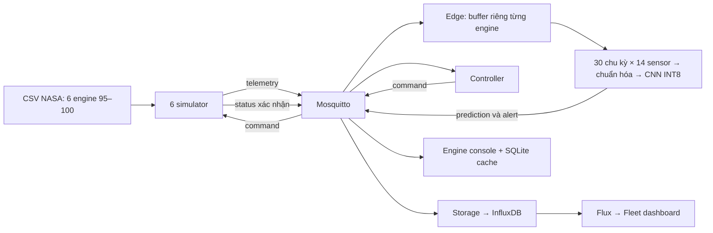

# AeroPulse — tài liệu học và demo cho Quan

Chuẩn bị cho sáng Chủ nhật **25/10/2026**. Tài liệu mô tả source tích hợp ngày 22/10; số đo mới nằm trong `docs/reference-results/2026-10-22/` (chỉ số liệu tổng hợp được xuất bản). Đây là demo trên laptop, dữ liệu động cơ mô phỏng.

## 1. Đọc theo thứ tự nào?

1. **10 phút:** đọc phần 2–4 để tự kể đường đi của một bản tin.
2. **15 phút:** đọc phần 5–6, mở hai dashboard và đối chiếu tên chỉ số.
3. **15 phút:** thực hành phần 7, giải thích bằng lời trong khi bấm.
4. **15 phút:** đọc [số liệu đã đo lại](metrics-20261022.md) và [câu hỏi phản biện](defense-questions-vi.md).
5. **Một lượt diễn tập:** chạy demo 5 phút, sau đó trả lời câu hỏi mà không nhìn tài liệu.

## 2. Câu giới thiệu 30 giây

“AeroPulse là mô hình AIoT cảnh báo sớm bảo trì động cơ. Chúng em phát lại dữ liệu NASA C-MAPSS qua MQTT, dùng mô hình CNN nhỏ dạng ONNX INT8 để phân loại nguy cơ hỏng trong 30 chu kỳ tiếp theo. Khi vượt ngưỡng, bộ điều khiển gửi lệnh lên lịch bảo trì và simulator xác nhận. Dashboard theo dõi từng động cơ và tổng quan 6 động cơ; InfluxDB lưu lịch sử để truy vấn.”

**Không nói:** dự đoán chính xác thời điểm hỏng, đã chạy trên vi điều khiển, đã sửa được động cơ, hoặc đã đủ an toàn cho động cơ thực.

## 3. Các công cụ làm gì trong dự án?

| Công cụ | Vai trò cụ thể | Đọc code |
| --- | --- | --- |
| Python + NumPy/Pandas | Đọc bảng dữ liệu, chia engine, tạo cửa sổ cảm biến | `src/aiot_pm/data.py` |
| scikit-learn | Chuẩn hóa dữ liệu và tính các metric | `data.py`, `benchmark.py` |
| PyTorch | Huấn luyện CNN và xuất model | `model.py`, `train.py` |
| ONNX | Định dạng model trao đổi giữa train và runtime | `models/*.onnx` |
| ONNX Runtime | Thực thi model trên CPU ở edge service | `edge_service.py` |
| MQTT / Mosquitto | Publish/subscribe: chuyển telemetry, prediction, alert, command, status | `mqtt_utils.py`, `schema.py` |
| InfluxDB 2.7 + Flux | Lưu dữ liệu có timestamp và truy vấn đội máy | `storage_service.py`, `fleet.py`, `dashboard/queries/` |
| FastAPI + Uvicorn | Phục vụ HTML và API cho trình duyệt | `dashboard.py` |
| HTML/CSS/JavaScript Canvas | Vẽ biểu đồ, nhận thao tác người dùng, gọi API định kỳ | `web/` |
| SQLite | Cache gần nhất cho trang engine khi MQTT mất kết nối | `dashboard_cache.py` |
| Docker Compose | Chạy các dịch vụ trong container và nối mạng nội bộ | `docker-compose.yml` |

MQTT là giao thức; Mosquitto là broker triển khai giao thức đó. Docker là môi trường chạy, không phải mô hình AI. “Edge” ở đây là vai trò kiến trúc: suy luận gần nguồn dữ liệu; hiện các vai trò cùng chạy trên một laptop.

## 4. Một bản tin đi qua hệ thống như thế nào?



1. Simulator lấy một dòng của `train_FD001.txt`, đóng gói `engine_id`, `cycle`, timestamp, 21 cảm biến và 3 thông số vận hành. Mỗi engine phát một chu kỳ mỗi 0,25 giây theo Compose.
2. Topic ví dụ: `aiot/engine/FD001-100/telemetry`. Broker phân phối bản tin cho các subscriber; publisher không gọi trực tiếp từng service.
3. Edge giữ bộ đệm riêng cho mỗi engine. Chưa đủ 30 dòng thì **chưa có prediction**. Sau đó mỗi dòng mới tạo một cửa sổ trượt mới.
4. Chỉ 14 sensor trong metadata được dùng làm đầu vào. Chuẩn hóa `z = (x − mean_train) / scale_train`, rồi chuyển thành tensor `[1, 14, 30]`.
5. CNN trả logit; sigmoid chuyển thành score 0–1. Score ≥ **0,64** là high; từ **0,448** đến dưới 0,64 là watch; thấp hơn là normal. Score được hiển thị như xác suất nhưng chưa có kiểm chứng calibration xác suất.
6. Edge xuất prediction và, khi high, alert với cooldown 10 giây cho từng engine.
7. Controller nhận alert, gửi `schedule_maintenance` nếu engine chưa nằm trong tập đã xử lý. Simulator đặt cờ bảo trì và phát status xác nhận.
8. Lệnh bảo trì **chỉ thay đổi cờ trạng thái**. Dữ liệu cảm biến vẫn chạy theo bản ghi; không có thao tác sửa chữa vật lý hoặc mô phỏng giảm hao mòn.
9. Storage lưu telemetry, prediction, alert, status vào InfluxDB. Command được console/cache quan sát nhưng storage hiện không lưu measurement command.
10. Khi hết quỹ đạo, simulator phát lại từ đầu. Đồ thị giảm đột ngột khi cycle quay về đầu là **replay**, không phải bằng chứng bảo trì thành công.

## 5. Train và inference là hai workflow khác nhau

**Train offline:** dữ liệu → chia 80 engine train/20 validation → fit scaler chỉ trên train → tạo cửa sổ → CNN → chọn checkpoint PyTorch theo F1 validation (có dò ngưỡng từng epoch) → export ONNX FP32 → calibration bằng tối đa 512 cửa sổ train → quantization tĩnh QDQ INT8 → chọn lại ngưỡng cuối bằng F1 validation của INT8 → lưu model cùng `models/metadata.json`.

CNN có hai lớp Conv1d, BatchNorm, ReLU, pooling và lớp Linear cuối; tổng **4.185 tham số**. Model học biến đổi theo thời gian của nhiều cảm biến. Chưa có thí nghiệm đối chứng đủ để nói CNN tốt hơn LSTM hay các baseline khác.

Nhãn: `1` nếu RUL tại cuối cửa sổ ≤ 30, ngược lại `0`. Với train run-to-failure: `RUL = max_cycle − cycle`. Với official test bị cắt trước hỏng: phải cộng RUL endpoint từ `RUL_FD001.txt`. Cùng số ID giữa train và official test không có nghĩa cùng một quỹ đạo.

**Inference online:** dùng nguyên trọng số/scaler/ngưỡng đã lưu; không train lại khi mở dashboard. Sáu engine dùng chung một model nhưng có bộ đệm riêng. Thêm engine làm tăng tải bản tin và suy luận, không tự cải thiện F1.

Bộ artifacts đang dùng là bộ của Quan, ngưỡng 0,64, đã đo lại. Bộ Xuân trong ZIP có ngưỡng 0,62 và trọng số khác; giữ riêng tại thư mục lưu riêng trên máy phát triển (không xuất bản). Không ghép metadata của bộ này với model của bộ kia.

## 6. Cách đọc hai dashboard

- [Fleet / tổng quan](http://localhost:8010/fleet): đọc prediction đã lưu trong InfluxDB, mặc định nhìn lại 24 giờ; refresh 10 giây. Mỗi engine chỉ tính một prediction mới nhất.
- [Engine 100](http://localhost:8010/?engine=FD001-100): đọc dữ liệu MQTT gần nhất; biểu đồ và điều khiển từng engine. Trang engine có thể xem cache khi MQTT offline nếu web server vẫn chạy.
- [API health](http://localhost:8010/api/health): kiểm tra cả nội dung `mode`, không chỉ HTTP 200; `degraded` nghĩa chưa live.
- [API docs](http://localhost:8010/docs): xem schema và endpoint. Nút Execute của endpoint command có tác dụng thật lên simulator.
- [InfluxDB](http://localhost:8086): xem lịch sử trong bucket `telemetry`; thông tin đăng nhập local giữ trong `.env`.

| Chỉ số Fleet | Ý nghĩa | Dễ nói sai |
| --- | --- | --- |
| Reporting / total | Engine có prediction mới dưới 60 giây / engine có prediction trong lookback | Không phải tổng số thiết bị trong registry cố định |
| Critical | Engine đang reporting và score ≥ 0,64 | Không phải số động cơ đã hỏng |
| Stale / Unknown | Prediction đã cũ từ 60 giây | Không được xem là healthy |
| Risk exposure | Số engine reporting vượt ngưỡng / số engine reporting × 100 | Không phải accuracy, cũng không phải xác suất cả đội sẽ hỏng |
| Ranking | Xếp score hiện tại của engine reporting | Không xếp theo thời gian hỏng thực |
| Histogram | Mỗi engine reporting đóng góp một mẫu | Không phải histogram tất cả cửa sổ train |

Ví dụ: 6 engine từng có dữ liệu, 1 stale, 2 trong 5 engine reporting vượt ngưỡng → coverage 83,3%, exposure 40%. Mẫu chỉ có 6 engine nên tỷ lệ biến động mạnh.

Console dùng normal/watch/high; Fleet gọi normal/warning/critical. Hai bộ tên ánh xạ cùng ngưỡng. Trạng thái freshness console mặc định 5 giây còn Fleet 60 giây; chúng không nhất thiết đổi trạng thái cùng lúc. Các KPI có thể lệch vài chu kỳ với console vì đi qua storage và refresh chậm hơn.

## 7. Tự chạy và trình bày từng bước

### Trước buổi demo

```bash
cd aeropulse-aiot-predictive-maintenance
open -a Docker
docker info
docker compose up -d --build
docker compose ps
curl -fsS http://localhost:8010/api/health
curl -fsS http://localhost:8010/api/fleet/summary
```

Đợi `docker info` trả thông tin Server trước khi chạy Compose; nếu báo không kết nối daemon thì Docker chưa sẵn sàng. Chờ engine đủ cửa sổ (tối thiểu khoảng 7,5 giây từ đầu replay), cộng khởi động/storage/refresh; thường dành 20–30 giây rồi kiểm tra. Health cần `status: ok`, `mqtt_connected: true`, `mode: live`. Cần thấy 12 service chạy: broker, database, edge, storage, controller, dashboard, 6 simulator. Fleet cần 6 engine 095–100 reporting. `localhost` chỉ dùng trên máy đang chạy; đây không phải link public.

### Xem InfluxDB theo từng bước

1. Chạy `INFLUXDB_URL=http://localhost:8086 INFLUXDB_ORG=aiot INFLUXDB_BUCKET=telemetry .venv/bin/python dashboard/create_general_dashboard.py` sau khi cấu hình `.env`; mở URL script trả về hoặc vào [InfluxDB → Dashboards → GENERAL_DASHBOARD](http://localhost:8086), đăng nhập tài khoản local nếu được hỏi; tên user `admin`, mật khẩu local nằm trong `.env`.
2. Chọn khoảng thời gian gần đây (Past 15m) để tránh nhầm lịch sử cũ; bật refresh nếu cần quan sát liên tục.
3. Muốn xem bản ghi gốc: mở **Data Explorer → Script Editor**, chạy query dưới đây. Mỗi dòng trả ra có engine, thời gian và score. Query chỉ đọc dữ liệu.

```flux
from(bucket: "telemetry")
  |> range(start: -5m)
  |> filter(fn: (r) => r._measurement == "prediction" and r._field == "failure_probability")
  |> group(columns: ["engine_id"])
  |> sort(columns: ["_time"])
  |> last()
```

## Thuật ngữ dùng khi giải thích số

- **RSS:** RAM đang thường trú của cả tiến trình, gồm Python/runtime/thư viện; không chỉ trọng số model.
- **P95:** mức trễ mà khoảng 95% lần đo không vượt quá; không phải trễ lớn nhất.
- **ROC-AUC:** khả năng xếp ca positive cao hơn negative qua nhiều ngưỡng; không phải accuracy tại ngưỡng 0,64.
- **Calibration INT8:** dùng dữ liệu đại diện để xác định dải giá trị/scale khi lượng tử hóa.
- **Calibration xác suất:** kiểm tra score 80% có tương ứng tần suất thật gần 80% không; việc quantize có calibration không có nghĩa xác suất đã được calibration.

### Kịch bản 5 phút

| Mốc | Thao tác | Lời giải thích chính |
| --- | --- | --- |
| 0:00–0:40 | Mở Fleet, chỉ 6 engine và reporting | Đây là tổng quan prediction mới nhất đã được lưu, không phải số liệu gán sẵn |
| 0:40–1:20 | Chọn engine 100, Open engine console | Mỗi engine có chu kỳ và buffer riêng; engine 100 thuộc validation |
| 1:20–2:10 | Chỉ sensor, probability, edge latency | 30 chu kỳ × 14 sensor; latency chỉ đo lời gọi model, không đo toàn hệ thống |
| 2:10–3:10 | Xem event alert → command → status | Controller tự lên lịch, simulator xác nhận bằng cờ; không có sửa động cơ thật |
| 3:10–3:45 | Reset maintenance flag | Chờ status clear/running; nếu risk vẫn cao, controller có thể lên lịch lại sau alert tiếp theo |
| 3:45–4:20 | Quay Fleet / mở InfluxDB | Số liệu lưu bền, truy vấn nhiều engine, giải thích stale |
| 4:20–5:00 | Mở bảng số liệu và giới hạn | Test endpoint F1 0,80; 7 false negative; INT8 giảm kích thước 24,87% |

Nếu engine đang ở đầu vòng và chưa high, tiếp tục giải thích kiến trúc trong khi chờ. Có thể bấm Schedule để minh họa đường điều khiển thủ công nhưng phải nói rõ đó **không phải** alert tự động. Không đổi ngưỡng hoặc sửa score để dựng cảnh báo.

### Xử lý sự cố

```bash
docker compose logs --tail=60 edge storage dashboard controller
docker compose restart simulator simulator_095 simulator_096 simulator_097 simulator_098 simulator_099
```

- Không prediction: kiểm tra engine đủ 30 dòng, edge đang chạy, model mount đúng.
- Console live nhưng Fleet lỗi: kiểm tra storage, InfluxDB và truy vấn Flux; Fleet không lấy dữ liệu từ SQLite.
- Fleet Unknown: nhìn age, kiểm tra simulator và storage; không gọi Unknown là normal.
- Web không mở: kiểm tra dashboard container và cổng 8010.
- Mất mạng Internet: hệ thống đã build và có dữ liệu/model local vẫn chạy được; tránh build lại nếu cần tải dependency.
- Dừng demo bằng `docker compose stop`; không dùng `down -v` vì sẽ xóa volume lịch sử.
- Tự quay video dự phòng từ bản đang chạy; video của máy phát triển không được phân phối trong repo.

## 8. Link tài liệu chính thức — đọc để hiểu phần đang dùng

1. [NASA C-MAPSS](https://data.nasa.gov/dataset/c-mapss-aircraft-engine-simulator-data): hiểu đây là dữ liệu mô phỏng suy giảm động cơ.
2. [MQTT](https://mqtt.org/): đọc publish/subscribe và QoS. Dự án dùng QoS 1, có thể nhận trùng bản tin.
3. [ONNX Runtime quantization](https://onnxruntime.ai/docs/performance/model-optimizations/quantization.html): đọc static quantization, calibration và QDQ; INT8 không bảo đảm nhanh hơn ở mọi phần cứng.
4. [Docker Compose](https://docs.docker.com/compose/): hiểu service, network, volume và vòng đời container.
5. [FastAPI](https://fastapi.tiangolo.com/): hiểu endpoint GET/POST và tài liệu OpenAPI tự sinh.
6. [InfluxDB OSS v2](https://docs.influxdata.com/influxdb/v2/): đọc measurement/tag/field và Flux; dự án dùng 2.7, không dùng API của InfluxDB 3.

## 9. Checklist nói số liệu với Linh và Phương

Thống nhất **model hash, threshold, tập dữ liệu, đơn vị mẫu, thiết bị, phiên bản runtime, cách đo latency** trước khi sửa slide. Dùng bảng `metrics-20261022.md` làm điểm đối chiếu; không trộn số từ model Xuân 0,62 với model đang demo 0,64. Việc trao đổi/chốt số với các bạn vẫn do nhóm thực hiện.
